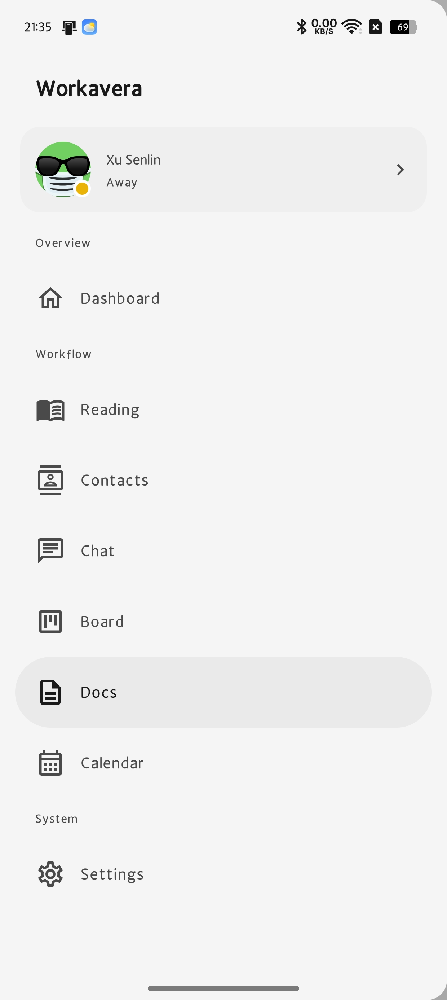
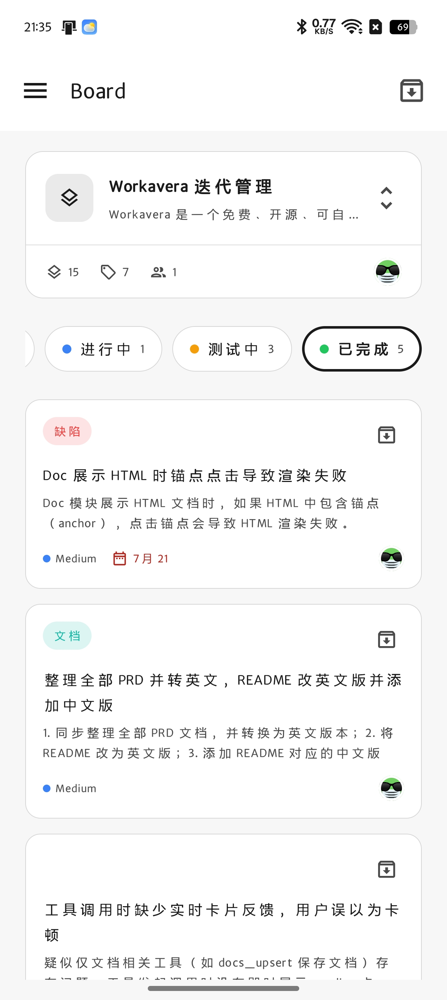
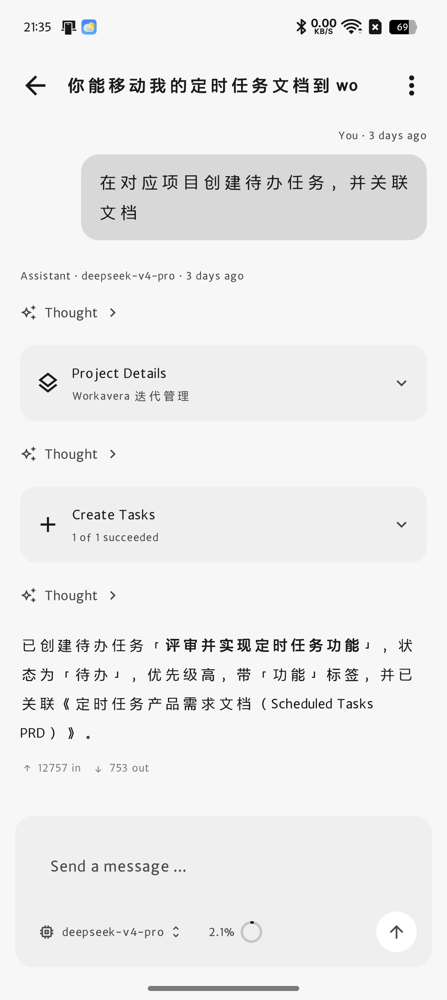

# Workavera Android

The Android client for Workavera (Kotlin + Jetpack Compose), connecting to a
self-hosted [Workavera](https://github.com/xusenlin/workavera) server
(PocketBase). The module structure mirrors the Web / iOS apps.

**This version needs a Workavera server on 0.0.10 or newer**, because task
archiving reads a field added in that release. Upgrade the server first. The
[server README](https://github.com/xusenlin/workavera#server-compatibility)
carries the full version table.

## Screenshots

| Navigation | Board | Chat |
| --- | --- | --- |
|  |  |  |

## Current status (1.0.3 preview)

- ✅ Sign in: email + password (`auth-with-password`), configurable server
  address, plain-HTTP LAN addresses supported
- ✅ Session restore: silent refresh with the local token at launch
  (`auth-refresh`), retryable on network failure
- ✅ Profile: real avatar (PocketBase file API + Coil), name, email, phone,
  bio; presence display and switching (online / away / busy / offline);
  edit profile, avatar crop & upload, change password
- ✅ Dashboard: greeting card, live stats (projects / tasks / next 7 days /
  unread reading), quick access links, disk-cached with pull-to-refresh
- ✅ Board: project switcher, state chips, task list; move tasks and edit
  priority / due date with optimistic updates; realtime refresh via SSE
- ✅ Notifications: paged list with unread badge, mark read / archive /
  delete, model-share accept & reject, realtime updates via SSE
- ✅ Reading: filter chips + search, paged link cards (pin / read / archive /
  delete), add-by-link sheet, detail sheet with AI fetch & summarize
  (per user + model data-sharing consent), mark all as read
- ✅ Contacts: live search + status filter chips, Favorites / Everyone
  sections, presence dots, detail sheet with favorite/unfavorite
  (`contact_favorites`), disk-cached with pull-to-refresh
- ✅ Chat: conversation list (search / pin / rename / archive / delete,
  archived sheet), SSE streaming replies with run resume & stop, reasoning
  and tool-call cards with approvals, context gauge, markdown with
  syntax-highlighted code blocks
- ✅ Full menu: Dashboard / Reading / Contacts / Chat / Board / Docs /
  Calendar / Notifications / Settings / Profile, grouped like the Web sidebar
- ✅ Tablet support: permanent sidebar at width ≥ 840dp (Material 3 Expanded
  breakpoint), drawer navigation on phones; dashboard grid and forms adapt to
  the window size

## Build & run

Open this directory with the latest stable Android Studio (the first sync
downloads Gradle 8.11.1 per `gradle/wrapper/gradle-wrapper.properties`;
JDK 17+ is required and ships with Android Studio). For command-line builds,
generate the wrapper scripts first: `gradle wrapper`.

- minSdk 26 / targetSdk 35
- The server address can be set at the bottom of the sign-in screen:
  - Emulator to a local dev server: `http://10.0.2.2:8090`
  - Physical device on the LAN: `http://<your computer's LAN IP>:8090`
  - Production instance: `https://your-server.example.com`

## Tech stack

| Layer | Choice |
| --- | --- |
| UI | Jetpack Compose + Material 3 (monochrome theme, follows system dark mode) |
| Navigation | Navigation Compose (drawer / permanent sidebar + NavHost) |
| State | ViewModel + Kotlin StateFlow (`AuthRepository` is the single source of truth for the session) |
| Networking | Ktor Client 3 (OkHttp engine) + kotlinx.serialization; PocketBase SSE for realtime |
| Images | Coil 3 + coil-svg (avatar loading; Workavera's preset avatars are DiceBear SVGs, so SvgDecoder is required) |
| Persistence | DataStore Preferences (server address, last sign-in email, session token) + disk response cache |
| DI | Manual `AppContainer` (small scale, no Hilt) |

## Code structure

```
app/src/main/java/com/workavera/android/
├── WorkaveraApplication.kt   # Application + AppContainer (manual DI) + Coil setup
├── MainActivity.kt
├── data/
│   ├── model/                # users / board / notifications / dashboard models
│   ├── network/
│   │   ├── PocketBaseApi.kt  # auth, profile, dashboard counts, board, notifications, SSE
│   │   └── ApiException.kt
│   ├── SettingsRepository.kt # DataStore: server address, email, token (scoped per server)
│   ├── AuthRepository.kt     # AuthState: Restoring / RecoveryFailed / LoggedOut / LoggedIn
│   ├── ResponseCache.kt      # disk cache for API responses, keyed per account
│   ├── DashboardRepository.kt
│   ├── BoardRepository.kt
│   └── NotificationRepository.kt
└── ui/
    ├── WorkaveraApp.kt       # root router: switches screens by auth state
    ├── AppSection.kt         # menu definition for all modules (matches Web/iOS)
    ├── AuthViewModel.kt
    ├── theme/                # monochrome Material 3 theme + status colors
    ├── components/           # AvatarView, StatusSelect, ErrorBanner, PaginationBar, …
    ├── login/                # sign-in, server settings dialog, session recovery
    ├── home/                 # adaptive scaffold, Dashboard, Settings, placeholders
    ├── board/                # board screen + view model
    ├── notifications/        # notifications screen + view model
    └── profile/              # profile, edit dialogs, avatar crop & preview
```
